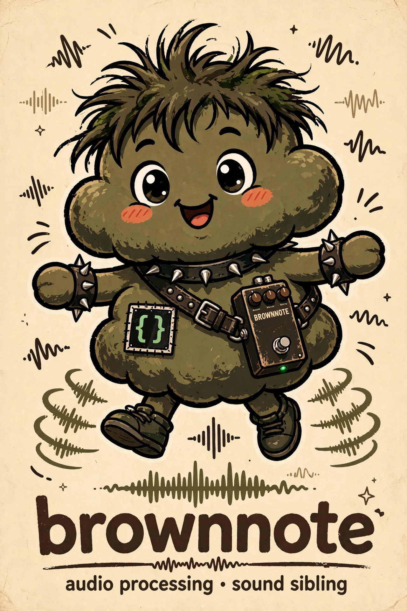

<p class="eyebrow">Field manual / brownnote</p>

# A fart goes in.<br>A pedal comes out. {#welcome .hero-heading}

Middleware between [fart-app](https://github.com/drawmeanelephant/fart-app)
and Linus Torvalds' [GuitarPedal](https://github.com/torvalds/GuitarPedal)
effects, feeding into [zcn](https://github.com/drawmeanelephant/zcn)/NINJAM:

```
fart-app | brownnote --effect fuzz | zcn
```

brownnote takes float samples in, runs them through the GuitarPedal test
bench — `Validation/bench`, the pedal's actual audio core compiled as a
host program, unmodified — and writes processed samples out. It implements
no DSP of its own: the bench binary *is* the pedal's signal path, and
brownnote is the plumbing between two programs that were never introduced.
The brown note must flow.



<div class="home-actions">
<a href="getting-started.html">Run your first effect</a>
<a href="guides/pipeline.html">Wire the pipeline</a>
</div>

<div class="specimen-card">
<div class="specimen-card__header">Two clones. Two makes. Zero DSP.</div>
<div class="specimen-card__body">

```bash
git clone https://github.com/torvalds/GuitarPedal.git vendor/GuitarPedal
make -C vendor/GuitarPedal/Validation bench
make
build/brownnote --effect fuzz < fart.wav > fuzzed.wav
```

</div>
</div>

## Pick your plumbing

<div class="feature-grid">
<div class="feature-card"><span class="edition-card__tag">01 / Build</span><h3 id="a-bench-and-a-binary">A bench and a binary</h3><p>A C compiler, GNU make, and a GuitarPedal checkout for the bench. No other dependencies.</p><a href="getting-started.html">Get the source</a></div>
<div class="feature-card"><span class="edition-card__tag">02 / Pipe</span><h3 id="wav-or-raw-floats">WAV or raw floats</h3><p>brownnote peeks at stdin: WAV gets converted, resampled, and written back; raw float32 stereo passes straight through the pedal.</p><a href="reference/formats.html">Input modes</a></div>
<div class="feature-card"><span class="edition-card__tag">03 / Chain</span><h3 id="the-full-rig">The full rig</h3><p>fart-app renders the phrase, brownnote runs it through the pedal, zcn checks the result or feeds a NINJAM room.</p><a href="guides/pipeline.html">fart → pedal → room</a></div>
</div>

## The joke is not the specification

This is source-first software for **macOS and Linux**, written in C with no
dependencies beyond the bench. Effect names, pot ranges, and resolution errors
come from the bench itself — `--list` prints its truth, and its exit codes
propagate unchanged.

- [[getting-started|Start here]] for a working first run.
- [[guides/index|Guides]] for the file pipeline, live rooms, and the recorded evidence.
- [[reference/index|Reference]] for flags, effects, formats, and exit codes.

No tracking, remote fonts, or application framework. This manual is compiled
to static files by [Boris](https://github.com/drawmeanelephant/boris).
