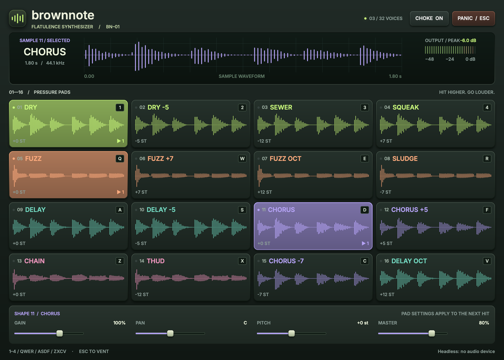

# Brownnote native pads

A standalone, 16-pad sample instrument built with Rust and Rune.
Play the included recordings, shape the next hit, and stop everything with Esc.



The hardware-style panel has illuminated, color-coded pads, a selected-sample
display, and a segmented output meter. Waveforms are peak-preserving,
normalized previews of the actual WAVs, not live scopes or spectra. They are
computed from owned media, off the audio thread. The pads show source
waveforms; the selected display follows the currently audible retained render.
Pad lights follow
actual voice counts, with a short input flash even on muted hits. The output
meter shows the engine's peak in dBFS with a decaying release; it is not a
calibrated loudness meter. The UI stops requesting animation frames at rest.

## Start playing

From the repository root:

```sh
make native
native/target/release/brownnote-native
# Equivalent:
cargo run --release --manifest-path native/Cargo.toml
```

On this Mac, if `cargo` is not found:

```sh
export PATH="/opt/homebrew/opt/rustup/bin:$PATH"
```

The app loads five WAVs without Python, GuitarPedal, kujamba, or a server.
Runtime defaults use the bounded executable-relative resource layout in
[Runtime paths](docs/paths.md), with a narrow development layout for the
commands above. No build-time checkout path is embedded in sample/tool
defaults. An arbitrary binary location can use explicit paths:

```sh
native/target/release/brownnote-native --samples /path/to/recordings
native/target/release/brownnote-native --no-audio
```

`--no-audio` runs the same mixer silently on the app clock. Missing or invalid
samples disable only the affected pads. A missing folder leaves the window
usable with a banner explaining `--samples`. Audio failures fall back to the
silent mixer and expose **RETRY AUDIO**.

Pedals use the C CLI that `make` builds:

```sh
make                                          # build/brownnote
make -C vendor/GuitarPedal/Validation bench   # the bench it drives
native/target/release/brownnote-native --list-pedals
```

Without either of those the app plays exactly as before, and the PEDALS tab
says what to build.

### Controls

- **AUDIO OUTPUT** opens the device and configuration panel. Tab, arrow keys,
  and Space reach its controls. **BACK TO PADS** restores the pads.
  Device or rate changes stop current voices. See the
  [output guide](docs/output-selection.md) for preference paths and recovery.
- Play `1234` / `QWER` / `ASDF` / `ZXCV`, matching the four grid rows.
  Keyboard hits use full velocity; held keys do not repeat.
- Click higher on a pad for a louder hit (top 100%, bottom 40%).
  Sound starts on pointer down, not release.
- A hit selects that pad. **GAIN** (0–150%), **PAN** and **PITCH**
  (−12 to +12 semitones) affect its **next** hit, not voices already playing.
- **MASTER** (0–100%, initially 80%) changes all output with a one-block ramp.
  Focus a slider and use arrows or Home/End; Escape cancels a slider drag.
- **CHOKE**, on initially, fades existing voices of the same sample file over
  5 ms on a new hit, even across different pads. Turn it off to stack hits.
- **PANIC** or **Esc** fades all voices over 5 ms to exact silence.
  Cmd/Ctrl/Alt shortcuts pass through; Cmd-Q still quits.
- The voice badge is the engine's actual voice count. The quick flash is
  immediate input feedback. PEAK decays after a hit.
- **SHAPE / PEDALS** switches the editor's lower half. SHAPE holds GAIN, PAN,
  PITCH and MASTER; PEDALS holds the selected pad's chain. Pad keys keep
  working while a pedal control has focus, and Tab reaches every pedal
  control.

Pitch changes playback speed and duration using linear interpolation; this
is not time stretching or a bandlimited pitch shifter. Pan is constant power.
The engine hard-clamps output to ±1. It has 32 active voices and 8 fading
stealing tails. A new hit starts immediately at capacity. If every tail is
occupied, the oldest tail stops, which can still click. Pad settings reset
on launch. Machine output preferences persist separately.

| Keys | Pads |
|---|---|
| 1 · 2 · 3 · 4 | DRY · DRY −5 · SEWER (−12) · SQUEAK (+7) |
| Q · W · E · R | FUZZ · FUZZ +7 · FUZZ OCT (+12) · SLUDGE (−7) |
| A · S · D · F | DELAY · DELAY −5 · CHORUS · CHORUS +5 |
| Z · X · C · V | CHAIN · THUD (−12) · CHORUS −7 · DELAY OCT (+12) |

Custom folders must contain `fart_dry.wav`, `fart_fuzz.wav`, `fart_delay.wav`,
`fart_chorus.wav`, and `fart_chain.wav`. `demo_brownnote.wav` is not a pad.
WAVs may be 16-bit PCM or 32-bit float, mono or stereo (averaged to mono),
8–192 kHz, from one frame through 30 seconds. Invalid or non-finite samples
produce file-specific errors. All files load before the audio stream starts.

## Pedals

Each pad can hold a chain of up to 4 GuitarPedal effects, picked from every
routable pedal the bench lists (22 of them, plus 5 system blocks that always
run and are never offered). The app reads the list from
`brownnote --list` at launch, so new upstream pedals show up without code
changes.

- Select a pad, open **PEDALS**, and press **+ PEDAL**. Effects already in the
  chain are disabled, because the bench refuses a duplicate route.
- Chips are in signal order. Click one to show its pots; `‹` and `›` move it,
  `×` removes it.
- Pots are 0..max with the list's default marked `DEF`. Pots with `max` of 4 or
  less are switches: they show the raw position, because `--list` has no names
  for switch positions.
- **MIX** stays at the effect's own default until you touch it; **RESET**
  returns it there. It is hidden for effects whose mix law is `none`. Escape
  during a drag cancels it and puts the previous value back, pots included.

A chain edit renders in the background through `brownnote`, and the pad's
next hit plays the result; the status reads `RENDERING…` then
`READY 0.4 s`, with `· CLIPPED` when the bench reported clipping. A hit
before the first render lands uses the assigned source. Further edits keep the
previous audible sound until the replacement is admitted, and a voice already
playing keeps the sample it started with. The render includes 2 s of silence after
the source so echoes and reverb ring out; trailing digital silence is trimmed
before playback.

Renders are cached on disk by content, so the same chain on the same sample
runs once; the clipping warning is cached with the audio, so it survives a
hit. The resolved user cache lives in `$HOME/Library/Caches/Brownnote/pedals`
(override with `--pedal-cache DIR` or `BROWNNOTE_CACHE`) and keeps the newest
256 entries. Required source and retained-render bytes are separately owned by
the unsaved session, never only by this evictable cache. See
[Import and runtime ownership](docs/import-contract.md) for the service and
store-adoption boundary. Runtime defaults follow
[Runtime paths](docs/paths.md); this is not a packaging claim. `--pedal-cache` may
name an existing folder of recordings: eviction only ever deletes files this
cache wrote, whose names are 16 hex digits. Only the moved pots are passed,
with names exactly as `--list` prints them.

`--brownnote PATH` points at a different `brownnote` binary for both the
catalog and the renders. Its runtime default is `tools/brownnote` beside
the executable, or `build/brownnote` in the bounded development layout.
`BROWNNOTE_BIN` also overrides it. `BROWNNOTE_BENCH` selects the bench;
otherwise it uses `tools/bench` (the checkout vendor path in development).
Both catalog and render calls pin this path with the C CLI's `--bench`,
so another working directory cannot supply a different vendor tree.

`--list-pedals` prints the routable catalog and exits without a window or an
audio device; a missing binary, a missing bench or an unparsable list prints
one line saying what to build and exits 3.

At their defaults the EQ-type pedals (Tone 1, Tone 2, Parametric EQ, Analog In
Tone, Analog Out Tone, Hum Filter) sound almost the same as the source,
because their gain pots default to flat. That is expected, not a render that
did nothing.

## Build and platform

Tested on macOS 27.3, Apple silicon, rustc 1.99.0. Other platforms are untested.
Rust edition 2024, minimum Rust 1.99. No project toolchain override is installed.

Direct dependencies:

- Rune git revision `cbaf637dfe5fcf3ec8b3f1c3ad27246b69742fbf`,
  default features, from <https://github.com/anomalyco/rune>.
- rune-fx from the same revision, and wgpu 30 for the compositor hook's types
  (features come from Rune's own wgpu). Only the look showcase draws with them.
- cpal `=0.18.2`, rtrb `=0.4.1`, hound `=3.5.1`.
- serde with derive, serde_json, and sha2 `=0.10.9` support project data,
  machine preferences, and content hashes. `Cargo.lock` fixes resolved versions.

Linux build packages (unverified): `libxkbcommon-dev` and `libwayland-dev`
for Rune, `libasound2-dev` for cpal. Headless rendering still requires a GPU
adapter (Metal on the tested Mac).

The main pad app loads the saved output choice before opening a stream.
**AUDIO OUTPUT** offers explicit selection, remembered retry, and a
system-default fallback. Supported formats are F32, I16, U16, and I32.
Stereo goes to channels 0 and 1, additional channels get silence, and a mono
device receives `(L + R) / 2`. No latency claim is made.

## Verify

From the repository root:

```sh
make native-test
make test  # Existing C workflow, independent of the native app.
```

For individual Rust checks and binary probes:

```sh
cd native
cargo fmt --check
cargo clippy --all-targets -- -D warnings
cargo test

# Audible, no window: pad 0 for two seconds, exit 0 only for frames and signal.
cargo run --release -- --check-audio

# The pedal catalog, with no window and no audio device.
cargo run --release -- --list-pedals

# Adds Tape Echo to pad 4's chain, for a real brownnote and bench to render.
cargo run --release -- --script scripts/pedals.json --at 6.0 --tree target/pedal-chain.json

# Silent, actual binary + virtual mixer + Rune GPU renderer:
cargo run --release -- --script scripts/smoke.json --at 0.6 --tree target/playing.json
cargo run --release -- --scene pedals --at 0.6 --tree target/pedals.json
cargo run --release -- --snap target/default.png
cargo run --release -- --scene playing --at 0.08 --snap target/playing.png
cargo run --release -- --scene missing-samples --snap target/missing.png
```

Engine tests cover both 44.1 and 48 kHz. A counting allocator checks the
callback's command-drain/render path for zero allocations and frees.
Rune Runtime tests exercise pointer, keys, sliders and missing assets.
They also check selection, meter decay, muted-hit feedback, and the minimum
820×600 layout. Waveform tests cover silence, transients and extreme samples.
The headless integration test launches the real binary, checks voice badges
before and after panic, and checks missing-folder errors. Screenshots alone do
not prove audio playback.

### What CI runs

`make native-test` runs everything, but a bare `cargo test` skips tests marked
`#[ignore = "needs a GPU adapter"]`. The three tests in `tests/headless.rs`
carry that mark because they launch the real binary and draw with Rune's GPU
renderer. The in-process `Runtime` tests (`ui_tests.rs`, `ui_pedals_tests.rs`,
`showcase/motion_tests.rs`) drive a virtual clock and need no adapter, so they
run in CI too.

`make native-test` adds `-- --include-ignored`, so it still runs the marked
tests locally, where a Metal adapter exists. Run them by hand with
`cargo test -- --include-ignored`, or just one with
`cargo test --test headless -- --ignored`.

The `native` job in `.github/workflows/ci.yml` runs on macOS and builds the
bench and `build/brownnote` first. It sets `BROWNNOTE_REQUIRE_BENCH=1`, which
turns a missing-bench skip in `tests/pedals_live.rs` into a failure, so the
catalog and render tests really ran against upstream GuitarPedal. Without that
variable they print the reason and pass, which is what happens on a machine
with no bench.

## Look showcase

`brownnote-showcase` draws the same instrument in three looks (Bunker, Space
Program, Afterhours) with an effect lab, tiers and measurement switches:
`cargo run --release --bin brownnote-showcase`. See [SHOWCASE.md](SHOWCASE.md)
for commands, the recommendation, the theme and control API, and measurements.

## Relationship to the studio

The web studio (`make studio`) stays the full workflow: sequencer, desk,
library, loop station, rendering and export. This native app uses the same
recordings and key layout, but has no shared state and no Python server.
The existing C CLI, Python studio and their tests are unchanged.

## Boundaries and next steps

The audio callback drains a bounded 256-command wait-free queue, mixes a
preallocated 32-voice pool, converts directly into the device buffer and
updates atomic meters. It does no allocation, locks, I/O, logging, or Arc
clone/drop, including while loading and retiring samples: a retiring sample
waits in its slot until the last voice reading it ends, then goes back to the
UI on a second bounded queue. UI queue overflow drops the command and reports
a count.
The virtual driver runs the same mixer, with at most 0.25 seconds rendered
per poll; it is a silent fallback, not a wall-clock playback guarantee.
Recovering or retrying a failed device starts a fresh voice pool.

Pedal chains and renders do not survive a quit, and there is no patch
persistence. Effects never run inside the audio callback: a render completes
off the UI thread, and swapping it in is a `Load` on the command queue. The
mixer holds 64 slots. One asset registry allocates sources and retained renders
together; shared encoded assets reuse a slot. Replacements wait rather than
overwrite occupied slots, and retired slots become reusable only after the
mixer returns them.

The import service is mounted through `State::import_sample`, without an
import control yet. Decoding, hashing, copying and retained-media preparation
run off the audio callback and ongoing UI interaction. The current session
owns encoded source/render bytes in memory. They are not durable until adopted
and saved through the real project store; no application save UI is claimed.

Also deferred: sequencer, desk/mixer, library, loop station, recording,
NINJAM, MIDI, sample browsing, hot reload, web/WASM, mobile,
and Linux/Windows pedal verification.
