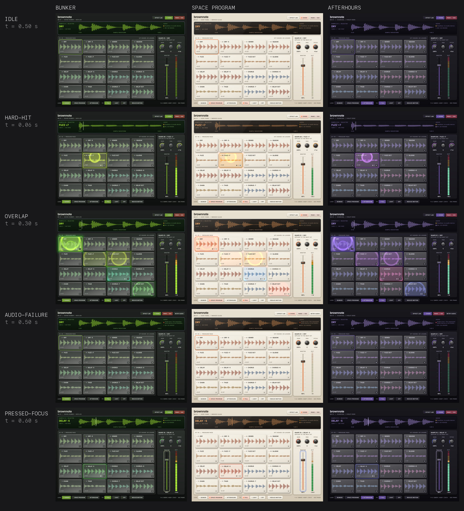
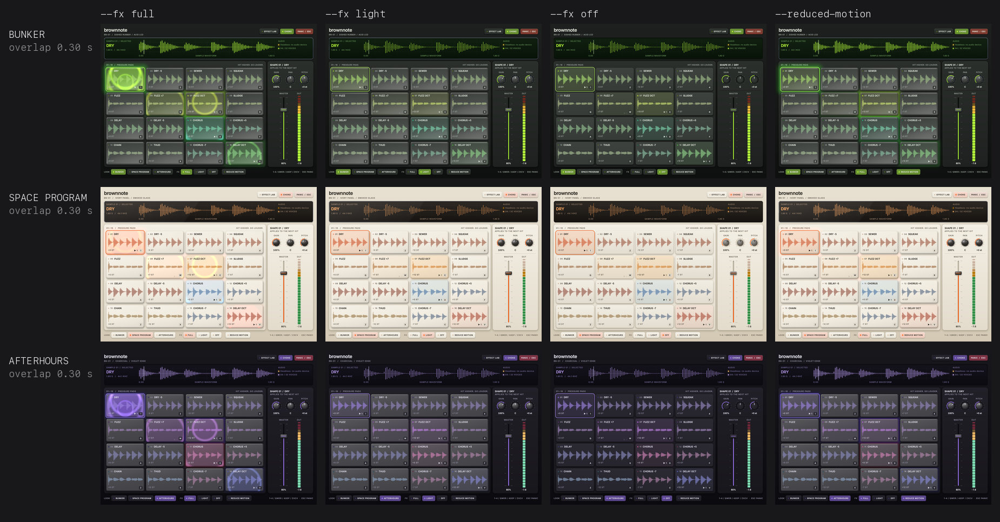
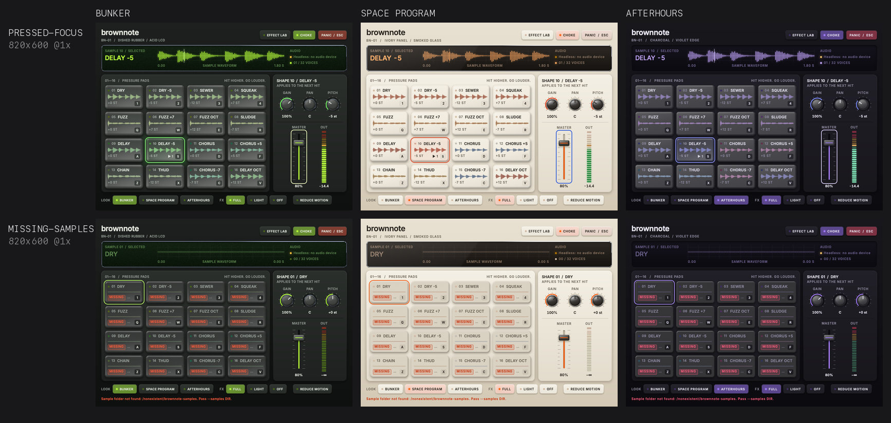

# Look showcase

A second binary, `brownnote-showcase`, plays the real kit through the real engine and draws it
three ways. It tests how far the native instrument's look can go on the pinned Rune revision,
with running controls rather than mockups. The main app, `brownnote-native`, is unchanged.

Three looks share one instrument:

- **Bunker**: dark industrial panel, acid-green LCD, dished rubber pads, gunmetal trim.
- **Space Program**: warm ivory panel, orange accents, smoked-glass display, chrome trim.
- **Afterhours**: charcoal panel, violet accents, a restrained emissive edge on lit pads.



[All ten scenes](docs/showcase/comparison-sheet.jpg) · [The three looks playing side by side (3 s, 60 fps)](docs/showcase/looks-side-by-side.mp4)

## Run it

From `native/` (on this Mac, first `export PATH="/opt/homebrew/opt/rustup/bin:$PATH"`):

```sh
cargo run --release --bin brownnote-showcase
cargo run --release --bin brownnote-showcase -- --look space --fx light
cargo run --release --bin brownnote-showcase -- --look afterhours --reduced-motion --no-audio
cargo run --release --bin brownnote-showcase -- --lab          # each effect alone, beside a baseline
```

| Flag | Effect |
|---|---|
| `--look bunker\|space\|afterhours` | Starting look. The footer switches looks live. |
| `--fx full\|light\|off` | Effect tier. `light` keeps the still materials (plastic, metal); `off` is plain Rune primitives, the baseline. |
| `--reduced-motion` | Drops ripples and uses Rune's reduced motion. The system setting also applies. |
| `--lab` | Opens the effect lab. **EFFECT LAB** in the header toggles it. |
| `--only plastic,glow,ripple,metal,grain,glass` | Draws only these effect kinds, for isolating cost. |
| `--probe` | Logs CPU and GPU frame timings, and in a window, input-to-submit times and pacing, to stderr. |
| `--samples DIR`, `--no-audio` | As in the main app. |

Rune's own flags work too, for example `--scene hard-hit --at 0.06 --snap out.png`,
`--video out.mp4`, `--size 820x600`, `--scale 1`, and `--native --trace FILE --frames N`.
Scenes: `idle`, `soft-hit`, `hard-hit`, `overlap`, `panic`, `focus`, `missing-samples`,
`audio-failure`, `storm`, `performance` and `lab`.

Keys, velocity, choke, panic and parameter ranges match the main app: `1234` / `QWER` / `ASDF` /
`ZXCV` hit at full velocity, a click hits louder higher on the pad, Esc panics. The knobs edit the
selected pad's next hit (GAIN, PAN, PITCH) and the fader sets MASTER; both take Tab focus, arrows,
Home/End and drags.

## Capture and measure

Build first: `cargo build --profile perf --bin brownnote-showcase`. Then, from `native/`:

```sh
python3 scripts/showcase.py stills    # 144 stills: 10 scenes x 3 looks x default/min x 1x/2x, plus tiers, lab, storm
python3 scripts/showcase.py sheet     # comparison sheets from the stills
python3 scripts/showcase.py clips     # 60 fps clips of the performance scene and lab per look
python3 scripts/showcase.py docs      # refresh docs/showcase from the sheets and clips
python3 scripts/showcase_measure.py --runs 5          # headless CPU/GPU cost, fresh process per run
python3 scripts/showcase_measure.py --vs OTHER_BINARY # paired A/B against another build
python3 scripts/showcase_native.py --runs 3           # real windows: pacing and CPU per frame
```

Output goes to `target/showcase/`. Stills and clips are headless captures on Rune's virtual
clock: they are deterministic and say nothing about desktop smoothness.

## Recommendation

| Treatment | Verdict | Evidence |
|---|---|---|
| Plastic fill on pads, knob caps and fader caps (rubber dish in Bunker, dome elsewhere) | **Ship**, in the light tier | Biggest visual gain per cost. Alone: GPU p50 +0.3 ms over the baseline. |
| Metal trim (gunmetal, chrome) on knob rings and display bezels | **Ship**, in the light tier | Still, no motion. Alone: +0.5 ms. |
| Pad light: 12 ms attack, 0.20–0.26 s release, velocity-scaled, sustained while the voice plays | **Ship** | Drawn as an overlay, not by animating the plastic colour. Labels keep ≥3:1 at a full flash and ≥4.5:1 while sustained (tested). |
| Soft glow (Bunker, Space Program) and neon edge (Afterhours) | **Ship**, full tier only | Most expensive single effect: +1.3 ms p50 under the storm. Stays inside the pad panel, clear of the display and meter (stills). |
| Ripple one-shots from the hit point | **Simplify**, then ship in the full tier | Per-pad pools (3 per pad, up to 48 live) pushed the storm to GPU p95 12.5 ms. One window-wide pool of 8 brings it to 7.6 ms; it only differs when more than 8 hits land within a ripple's 0.55 s life. Off under reduced motion. |
| Meter: instant attack, 140 ms release, held peak that fades in place, 1.5 s clip latch | **Ship** | Driven by the engine's atomic peak. Passes the motion gate. |
| Display bloom (blurred copy of the ink, Rune blur) | **Ship**, full tier only | Reads as phosphor without softening the trace. |
| Smoked-glass sheet (gradient over the display) | **Ship** for Space Program | Plain gradient, no shader. |
| Display grain | **Simplify**: Bunker only | At 0.05 it moves display pixels by about 2 levels in 255 on average (12 at most), at 1× and 2× alike: faint LCD texture. Afterhours' 0.02 did not show on its near-black display, so it is now 0. Alone: +0.4 ms, mostly the fixed cost of an effect pass. |
| Lens glass over the display (rune-fx lens) | **Reject** | Blurs and refracts the waveform, the thing the display exists to show (see the lab still). |
| Scene lighting (rune-light) | **Reject at this revision** | rune-light renders a whole frame in its own compute pass. It does not fit as a layer at an effect slot, so it was not attempted. |
| Shader prewarm | **Not available** | The only whole-pipeline builder is a hidden test helper. First use costs about 1 ms CPU instead (below). |



All three looks are shippable. They pass the same contrast, layout, focus and motion tests, and
cost within 0.7 ms GPU p50 of each other under the storm. Bunker gives the clearest hit feedback against its dark
ground. Space Program's light faces wash out glow, so its feedback leans on the face light and
ripple. Afterhours is the quietest and cheapest of the three.

## Theme and control API

`src/look/` is the reusable part. It holds no instrument state.

- `theme`: tokens. `Theme` groups `Palette`, `Typography`, `Materials` (`Material`, `Metal`),
  `Space`, `Motion` (attack, release, sustain, ripple life, glow kind and strength, meter release
  and peak hold) and `Surfaces` (grain, bloom, glass, how much of a pad's face its light covers).
  `ThemeId` names the three looks; `FxLevel` is the effect tier.
- `controls`: builders that return plain `El`s from a `Skin` (theme, tier, reduced motion,
  effect mask): `panel`, `led`, `button`, `display`, `bloom`, `waveform` and `playhead`, `pad`
  and `pad_glow`, `knob`, `fader`, `meter`. The instrument adds keys, handlers and values.
- `motion`: settling state an instrument owns: `PadLight` (attack, release, sustain), `Meter`
  (peak, hold, clip latch) and `Ripples` (one window-wide pool of `RIPPLE_BUDGET` one-shots).
  Each reports `settled` so the window stops drawing when nothing moves.
- `fx`: effect slots (`plastic`, `glow`, `ripple`, `metal`, `grain`, `glass`) and `Look`, the
  compositor that turns slots into rune-fx layers. Rune keeps layout, clipping and hit testing.
  `Look::probed` adds CPU and GPU timing.

```rust
let skin = Skin { theme: ThemeId::Afterhours.theme(), fx: FxLevel::Full, reduced_motion, mask: fx::ALL_KINDS };
let gain = knob(&skin, &KnobView { key: "gain", label: "Gain", value, display: &text, accent, bipolar: false },
    |body| body.on_step(|s: &mut State, steps, _| s.gain += steps as f32 * 0.05));
// The app state implements fx::Settling, so the window keeps drawing only while motion settles.
rune::App::new(spec).compositor(Look::default()).run();
```

`src/showcase/` is the instrument: kit, engine, output, settings, keys and scenes. Nothing in
`look` or the showcase runs on the audio thread; the callback is the main app's, unchanged.

## Measurements

Apple M4, macOS 27.3, 120 Hz display, perf profile. **Storm** hits every pad every 120 ms for
2 s, so every light, the meter and the full ripple budget are live at once.

**Headless frame cost** (`target/showcase/measure/report-final.txt`): 5 fresh processes per row,
2× scale at 1120×800, medians of each run's p50 and p95. CPU is Rune's update plus the
compositor's encode on the main thread. GPU is the time between timestamps around the frame's
passes. No presentation or window server is included.

| Look | Tier | Storm CPU p50 / p95 | Storm GPU p50 / p95 | Idle GPU p50 | Effect layers |
|---|---|---|---|---|---|
| Bunker | off | 0.46 / 0.54 | 4.32 / 4.35 | 3.63 | 0 |
| Bunker | light | 0.49 / 0.57 | 4.37 / 4.40 | 3.61 | 24 |
| Bunker | full | 0.61 / 0.79 | 6.21 / 7.59 | 4.02 | 57 |
| Bunker | full, reduced motion | 0.53 / 0.66 | 5.75 / 6.27 | – | 41 |
| Space Program | off | 0.47 / 0.54 | 4.33 / 4.36 | 3.64 | 0 |
| Space Program | light | 0.50 / 0.57 | 4.55 / 4.59 | 3.79 | 24 |
| Space Program | full | 0.61 / 0.80 | 5.97 / 7.40 | 4.10 | 56 |
| Space Program | full, reduced motion | 0.53 / 0.65 | 5.53 / 5.98 | – | 40 |
| Afterhours | off | 0.47 / 0.54 | 4.33 / 4.37 | 3.62 | 0 |
| Afterhours | light | 0.50 / 0.57 | 4.28 / 4.32 | 3.52 | 20 |
| Afterhours | full | 0.62 / 0.80 | 5.51 / 7.08 | 3.83 | 52 |
| Afterhours | full, reduced motion | 0.52 / 0.67 | 5.06 / 5.63 | – | 36 |

All times in ms. One effect at a time (Bunker, storm, `--only`), GPU p50 / p95: none 4.32 / 4.35,
plastic 4.58 / 4.71, grain 4.76 / 4.90, metal 4.77 / 4.92, ripple 5.09 / 5.77, glow 5.62 / 6.39.

A 120 Hz frame has 8.33 ms. The full tier's storm p95 leaves about 1 ms of GPU headroom here; the
light tier leaves about 4 ms. A slower GPU should default to the light tier. Every row, `off`
included, has single GPU frames of 6–10 ms, so maxima are not attributed to effects. GPU times
are elapsed time at whatever clock the GPU chose, which is why an idle frame looks expensive.

**First use**: the first frame compiles 1–3 effect pipelines and costs 4.7–4.9 ms CPU against
3.7–3.9 ms with effects off. The first hit compiles 2 more: 1.1–1.3 ms CPU on that frame and
0.8–0.9 ms on the next. Steady-state CPU p95 stays under 1 ms in every row.

**Native windows** (`target/showcase/measure/report-native.txt`): 3 fresh windows per row,
Retina, display-link pacing, 300 frames traced with Rune's `--native --trace`. A missed refresh
is a frame presented two or more refreshes after the previous one.

| Row | Missed after the first 1.2 s (3 runs) | CPU per frame p50 / p95 / max (ms) |
|---|---|---|
| Bunker, off, storm | 0/211, 0/217, 0/211 | 1.35 / 2.31 / 2.8 |
| Bunker, light, storm | 0/210, 0/210, 0/211 | 1.36 / 2.44 / 2.9 |
| Bunker, full, storm | 0/216, 0/217, 0/216 | 1.58 / 2.48 / 3.0 |
| Space Program, full, storm | 0/217, 0/218, 0/216 | 1.57 / 2.50 / 2.9 |
| Afterhours, full, storm | 0/215, 0/218, 0/217 | 1.52 / 2.60 / 3.2 |
| Bunker, full, storm, reduced motion | 0/213, 0/215, 0/217 | 1.38 / 2.45 / 3.0 |
| Bunker, full, performance | 0/160, 0/159, 0/159 | 1.39 / 2.53 / 3.4 |
| Space Program, full, performance | 0/161, 0/160, 0/160 | 1.32 / 2.60 / 2.9 |
| Afterhours, full, performance | 0/159, 0/159, 0/159 | 1.39 / 2.62 / 3.1 |

CPU here is what Rune's trace records per frame, tracing included. These runs used the build
before the last two changes (Afterhours' grain removed, the audio column fix), which only remove
work or reflow one text column. The rerun on the final build could not draw: the display had
gone to sleep, which stops the display link (`report-native-attempt-display-asleep.txt`).

For about the first second after launch, a window that animates from its first frame is paced at
60 Hz on this Mac, with effects off as much as on. After that, no row missed a refresh.

**Not measured**:

- End-to-end input latency (key press to photons). Automated key presses need Accessibility
  permission, which this session did not have. To measure input-to-submit by hand, run
  `target/perf/brownnote-showcase --probe --no-audio`, play keys, and read the `latency` lines on
  stderr. They time from the OS event to the frame's submit and its target refresh, not photons.
- GPU time in a window: timestamps are headless only.
- Other GPUs, Intel Macs, Windows and Linux.

## Failed and rejected experiments

- **Pad light by animating the plastic colour.** The motion gate read the effect payload as
  colour snaps. The light is now its own overlay with a pulse intent.
- **Playhead as a stroke inside the waveform.** Every move redrew the waveform, which the gate
  flagged as flicker. The playhead is now its own element over a still waveform.
- **Held peak gliding down.** It flashed segments on the way. It now stays where it landed and
  fades in place.
- **Per-pad ripple pools.** Too many layers under the storm (above).
- **A 16 ms settle wake.** It drew motion at 60 Hz on the 120 Hz panel. The showcase now asks for
  the next frame while anything settles. The main app's `ui.rs` still advances its flash and meter on
  a 33 ms poll while anything is lit, so they step at about 30 Hz; that is a separate change.
- **Lens glass, rune-light, shader prewarm**: rejected or unavailable (above).
- Rune's `check-native-pacing.py` assumes the trace header's refresh rate. The header said 60 Hz
  while the display ran at 120 Hz, so its "short gaps" failures were an artifact;
  `showcase_native.py` reads present intervals in refreshes instead.

## Tests



`cargo test` covers, per look: hits through the real velocity curve and key paths (repeat and
modifiers ignored, Esc panics), muted-master feedback, overlap bounds and settle-to-idle,
default and minimum window layout in every tier (including long audio errors and missing
samples), Tab focus with a visible ring on every control, contrast of text, focus and lit pad
labels, and the effect tiers. `motion_gate_every_look_hits_overlaps_panics_and_goes_quiet` runs
Rune's motion gate over 18 recordings (3 looks × reduced or not × hit, overlap, panic) and fails
on snaps, flicker, jumps or a window that keeps drawing after it settles.
